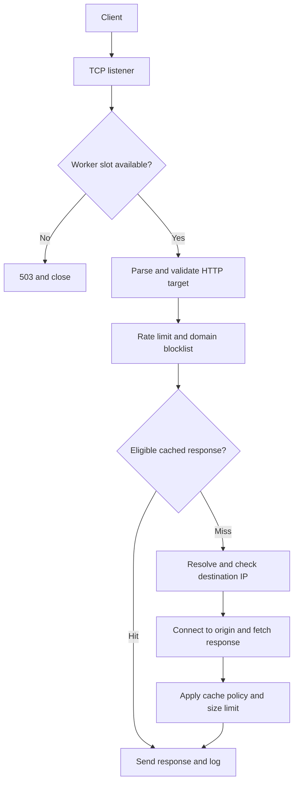

# Architecture

The proxy sits between a client and an HTTP origin. A client connects to port 8888 and sends an absolute target such as `GET http://example.com/page HTTP/1.1`. The proxy creates a separate outbound connection and sends the origin-form target `/page` with a reconstructed Host header.

## HTTP framing

`BaseHTTPRequestHandler` handles request line/header parsing, and `http.client` handles response status, headers and chunk decoding. GET and HEAD cannot carry bodies in this implementation. Duplicate Content-Length headers and Transfer-Encoding are rejected to avoid ambiguous request framing. Each client connection serves one request, so unread data cannot become a second request.

Connection-specific headers and fields named in the Connection header are removed in both directions. The proxy reconstructs Host and Content-Length and sends `Connection: close`. HEAD sends no body but retains the origin representation length. HTTPS CONNECT and mutation methods are explicitly unsupported.

## Concurrency and resources

A TCP listener dispatches to a fixed-size `ThreadPoolExecutor`. A semaphore caps active handlers without permitting an unbounded executor queue. Cache operations and limiter operations use separate locks; origin I/O happens outside those locks. Logging has its own lock so JSON records cannot interleave. Ctrl+C invokes shutdown from another thread and waits for active workers. OS DNS resolution can extend shutdown beyond the socket timeout.

## Cache policy

The key includes host, port, path/query and all forwarded end-to-end request headers. This is deliberately conservative: differences in request headers produce different entries. Only ordinary GET 200 responses are candidates. Authorization, Cookie, Range and conditional requests bypass lookup and storage, as do request no-cache/no-store directives.

Responses with Vary, Set-Cookie or prohibitive Cache-Control directives are never stored. Otherwise the local TTL is bounded by cache_ttl and an origin max-age directive, with origin Age deducted. Expired entries become misses. Hits update LRU order; inserts evict least-recently-used entries until the approximate byte budget fits. Large responses are rejected before delivery. Cache entries are immutable tuples shared safely after lock release.

This is a small educational cache rather than a full shared-cache implementation. It has no validators, disk persistence, cache stampede suppression, precise Date/Expires age calculation or invalidation API. Concurrent cold requests can independently fetch the same resource. Cache hits may continue serving an already-cached resource until its short TTL expires without repeating DNS resolution.

## Access control

Domain blocking checks normalized hostnames and subdomains before cache lookup. Rate limiting is based on the real TCP peer IP, not untrusted forwarded headers. A sliding-window deque tracks request times; inactive client records are reclaimed.

By default every DNS answer must be a global IP. The connection uses a checked address directly, preventing a second DNS lookup from changing the destination. Demo/test configuration allows private destinations for the local origin. The implementation uses the first resolved address and does not implement address fallback.

## Errors and observability

| Status | Trigger |
| --- | --- |
| 400 | Invalid absolute HTTP URL or unsupported request framing |
| 403 | Blocked domain or non-global destination |
| 405 | Unsupported mutation method |
| 429 | Client exceeded the sliding-window limit |
| 501 | HTTPS CONNECT unsupported |
| 502 | Origin connection/protocol failure or response too large |
| 503 | All worker slots occupied |
| 504 | Origin socket operation timed out |

Traffic logs use UTC ISO timestamps. The destination is host:port; URL queries and credential header contents are not logged. A log contains cache status, method, response status, body bytes and processing latency. Parser-generated errors are logged through the response helper; worker-overload 503 and connections that never form a valid request are not logged. File logging is synchronous and requires a writable destination.
