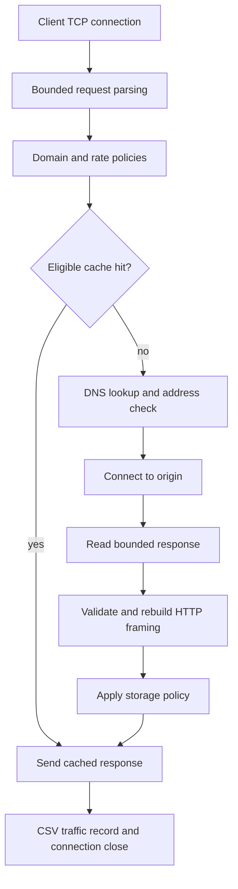

# C proxy architecture

The TCP listener accepts clients on loopback. It admits at most 32 workers, using native threads on Windows and detached pthreads on Linux. Each worker handles one HTTP request and closes its client socket. Mutexes independently protect the cache, limiter, log and active-worker count.

## HTTP parsing and forwarding

The request reader requires CRLF header termination, with a 16 KiB bound. The parser accepts absolute `http://` targets, ASCII DNS/IPv4 hosts and GET/HEAD. User information, fragments, IPv6 literals, bodies, duplicate Content-Length and Transfer-Encoding are rejected. Each client handles one request, so pipelining is unsupported.

The outbound message uses origin-form paths and HTTP/1.0, with Host reconstructed from the target URL. Hop-by-hop headers and fields named by Connection are removed. The origin is resolved once, checked, and contacted using a resolved sockaddr. The proxy tries available IPv4 addresses. Nonblocking connect plus select bounds the connect wait; socket read/write timeouts bound individual operations. DNS lookup and a peer sending occasional data can extend the total duration.

Responses are buffered up to 1 MiB including origin headers. The parser checks the status, header syntax, duplicate content lengths and declared body size. Chunked responses are rejected rather than incorrectly relayed. Response Content-Length and Connection are rebuilt, and `X-Proxy-Cache` exposes the result. HEAD retains the declared representation length and sends no body. Byte lengths, not strlen, are used when copying response bodies, so embedded NUL bytes are preserved.

## Cache and ownership

Sixteen entries contain a copied key, copied response buffer, byte length, expiry and last-used time. The key is the reconstructed outbound request, including forwarded headers. A hit copies data under the mutex, then releases the lock before network I/O. This prevents another worker's eviction from invalidating a response buffer in use. Inserts allocate owned copies, choose an expired/empty slot or the least recently used entry, and free its previous allocations.

GET 200 responses are candidates; authorization, cookies, range and conditional requests bypass caching. Request Cache-Control/Pragma bypass conservatively. Response directives, Vary and Set-Cookie can prohibit storage. Configured TTL is capped by max-age/s-maxage and reduced by origin Age. This cache does not implement revalidation, complete freshness accounting, request coalescing or disk persistence. A HIT header is padded with one trailing space to keep the cached wire length stable.

## Access policies

Domain filtering compares normalized names with exact and dot-boundary suffix matches. The blocklist is loaded at startup. The per-client limiter stores a bounded timestamp array, removes events outside the sliding window and returns 429 when the limit is reached. The TCP peer IP is used rather than a forwarded header. Saturated client tables reject new live identities to avoid bypass through eviction.

Private destination filtering conservatively rejects common private, loopback, link-local, multicast, shared and reserved ranges. It operates on every resolved IPv4 address. The allow-private switch is required for local demonstrations. It is not a full IANA address registry implementation and should not be presented as a production security boundary.

## Logs and errors

CSV logging is mutex-protected and flushed after each record. Hostnames are restricted to characters safe for a CSV field. Timestamps use UTC; monotonic time measures latency and expiry. Successful records contain response wire bytes. Errors include 400 malformed requests, 403 policies, 405 methods, 429 rate limits, 501 CONNECT, 502 origin/framing/size failures, 503 admission/allocation failure and 504 origin read failure/timeouts. Overload responses and partial client disconnects may not produce full records.

Shutdown stops the listener and waits until active workers reach zero before freeing cache allocations and closing the log. Error paths release response buffers and upstream sockets. The fixed cache can retain roughly 16 MiB of response data plus keys and allocation overhead; active workers have additional bounded response buffers.
